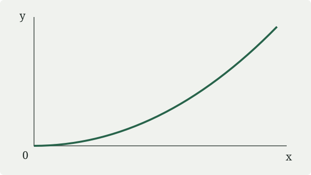

This is a private draft for testing the writing setup. Replace it with your own
post before publishing.

## Equations

Kramdown uses double dollar signs for both inline and display math. An inline
equation such as $$E = mc^2$$ sits within a sentence.

Put an equation on its own lines for display math:

$$
\int_{-\infty}^{\infty} e^{-x^2}\,\mathrm{d}x = \sqrt{\pi}.
$$

## Figures

SVG diagrams and PNG, JPEG, WebP, or GIF images use the same Markdown syntax:



For a caption and explicit dimensions, use HTML:

<figure>
  
  <figcaption>An example SVG figure.</figcaption>
</figure>

## Code and lists

```python
def energy(mass, speed_of_light):
    return mass * speed_of_light**2
```

- Write in Markdown.
- Keep figures in `assets/images/`.
- Publish when ready.
