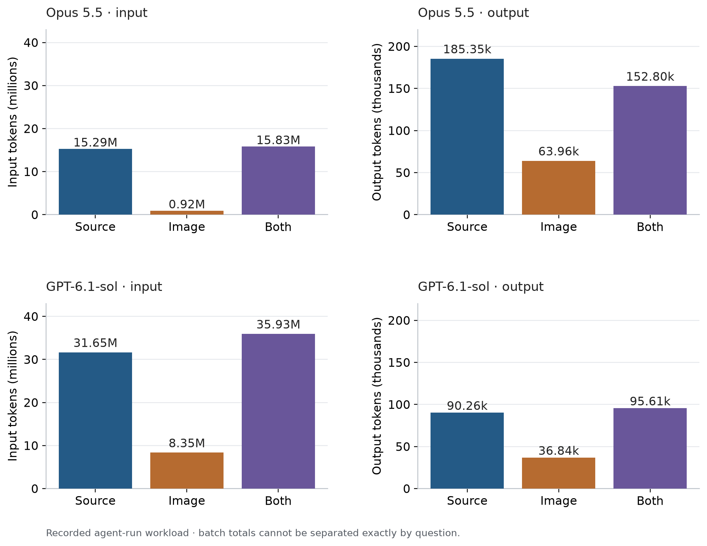

We ask how much a rendered image helps when the same visual information is available as text. Our dataset contains 200 questions about artwork, photographs, interfaces, floor plans, 3D objects, maps, charts, circuit boards, textures and PDFs.

On the same 200 questions, source alone reached 88.5% for Opus 5.5 and 93.0% for GPT-6.1-sol. Image-only scored 88.0% and 93.0%; combining source and image reached 95.5% and 96.5%. Image-only used substantially fewer input and output tokens for both models.

<nav class="article-contents" aria-label="In this article">
In this article<a href="#context">Context</a><a href="#setup">Setup</a><a href="#experiment">Experiment</a><a href="#results">Results</a><a href="#conclusion">Conclusion</a>
</nav>

## Context

While building computer-use environments at Seldon, we noticed that agents often solve CAD and engineering tasks by scripting the design. Some achieved high rewards without inspecting the rendered 3D model. That raised a question: how much does looking at the result actually help when the agent already has the code?

One explanation is that these tasks lend themselves particularly well to scripting. This cannot be fully ruled out. Many of the formats we use here describe geometry and layout in readable text. For example, [ASCII DXF stores an AutoCAD drawing as text](https://help.autodesk.com/cloudhelp/2023/ENU/AutoCAD-DXF/files/GUID-FC1C3C69-DBC2-49E4-893A-000D6538C0FE.htm).

If the source and rendering settings fully specify an image, the model could in principle recover the answer from that source. The practical questions are whether it does so reliably, how much work it uses, and whether an image improves the result.

[Sharma et al. (2024), *A Vision Check-up for Language Models*](https://arxiv.org/pdf/2401.01862), tested whether language models could recognise human drawings represented as graphics code.

We extend recognition from drawing code to representations including raw pixel values, triangulated meshes, photograph-derived polygons and engineering files. We compare source-only, image-only and combined inputs to measure when supplying a render improves accuracy and how token usage changes.

## Setup

The dataset contains 200 source-and-question items across 13 question types. Each item includes its source, a rendered image (PNG or PDF), a question and an answer key.

Most questions concern an object, a spatial relationship or a visible defect. “What does this depict?” and “Is a door blocked by furniture?” are typical examples. We do not restrict the model to a visual solution: deriving the answer analytically from the source is allowed.

The **blind model** receives the source and the question. The source depends on the item:

Explore the dataset · 13 question types, 200 questions

| Question type | Tasks | Source supplied to the model | Typical question |
|---|---:|---|---|
| Emoji artwork | 25 | SVG paths | What person, emotion, animal or object is depicted? |
| SVG charts | 7 | SVG points, paths and axes | What figure do the points form, or is the chart misleading? |
| Photographs drawn in SVG | 8 | Flat-colour polygons | What is the main subject? |
| Photographs drawn in HTML | 8 | HTML and CSS clip paths | What is the main subject? |
| Text bitmaps | 8 | PPM colour values or an XPM character grid | What is the main subject? |
| Web interfaces | 25 | HTML and CSS | Is there a visible layout defect? |
| Floor plans | 22 | ASCII DXF | Is there a design fault? |
| 3D scans | 15 | OpenSCAD vertices and triangles | What object does the mesh depict? |
| Maps | 12 | GeoJSON polygons | Which country or state is shown? |
| Charts as code | 10 | Matplotlib or Vega-Lite | What trend or misleading design is present? |
| Circuit boards | 10 | KiCad board text or Gerber commands | What board or connectivity fault is present? |
| Textures and lighting | 30 | SVG filters, POV-Ray, Blender Python or CSS | Which material, surface or lighting appearance is shown? |
| Vector documents | 20 | Complete, uncompressed ASCII PDF | What do the charts, diagrams or page relationships show? |
| **Total** | **200** | | |

The **eyed model** receives the image and question. The **blinking model** receives the source, image and question. Each condition uses the same model in a fresh context.

The runs use Opus 5.5 and GPT-6.1-sol, both with medium reasoning. Opus runs Claude CLI; GPT runs through Codex. Participants receive their assigned inputs in a fresh context. They may read those inputs and write answers, but may not execute the source, run a decoder or renderer, or inspect other files. Image conditions receive every relevant page.

All 200 questions use fixed answer options, with 4–36 listed choices per question.

## Experiment

We test Opus 5.5 and GPT-6.1-sol both in their own coding harnesses. Both models answer the same 200 questions with the same options and fixed scoring rules in all three conditions.

We ensure the answerability of the questions by reviewing them and answering them from the images.

One example supplies 25,229 characters of OpenSCAD source: 3D point coordinates and the point indices defining each triangle. The question asks what the surface depicts, with 27 answer options. GPT-6.1-sol answered **“cartoon man (Homer Simpson)”** correctly from the source alone.



## Results

Source performance depends on the question type. Explicit geometry supports many correct answers without a render. Recognising photographs from long lists of polygons or pixels is harder. Circuit-board questions can favour source because connectivity and net identities are easier to recover from the file than from the chosen view.

### Accuracy

| Model | Source only | Image only | Source and image |
|---|---:|---:|---:|
| Opus 5.5 | 177/200 · 88.5% | 176/200 · 88.0% | 191/200 · 95.5% |
| GPT-6.1-sol | 186/200 · 93.0% | 186/200 · 93.0% | 193/200 · 96.5% |

Each entry is correct answers out of the same 200 questions. Each model produces one scored answer per question and condition.

Both models answered every emoji, SVG-chart, interface, floor-plan, map, code-chart and PDF question correctly from source.

Photograph recognition was harder. Across the 24 photograph-derived items, Opus scored 10/24 from source, 21/24 from images and 22/24 from both. GPT scored 16/24, 23/24 and 21/24. On the 15 meshes, Opus scored 8, 12 and 13; GPT scored 11, 13 and 13.

Circuit boards favour source. Opus scored 10/10 from source, 4/10 from images and 9/10 from both; GPT scored 10/10, 6/10 and 10/10. Source contains exact connectivity and net identities, while a rendered view can hide a missing track segment.

Adding images to source corrected 18 Opus errors and introduced four, a net gain of 14 answers. For GPT it corrected nine and introduced two, a net gain of seven. The Opus corrections concerned six meshes and twelve photograph-derived items; its introduced errors concerned one board, one mesh and two textures.

Both models answered all 20 PDF questions correctly in every condition. On textures, Opus matched 28/30 construction labels from source, 22/30 from images and 26/30 from both. GPT matched 28/30, 24/30 and 28/30.

<section class="figure-discussion" aria-labelledby="token-usage">

### Token usage

Image-only used 94% fewer input tokens and 65% fewer output tokens than source-only for Opus; the reductions for GPT were 74% and 59%.

Adding images to source increased input tokens by 4% for Opus and 14% for GPT. Output tokens fell by 18% for Opus and rose by 6% for GPT. These are recorded agent-run totals, including repeated context and input loading. Tokenizers, tool interfaces and batch sizes differ between models. Batch totals cannot be separated exactly by question.

<figure class="chart-figure">

<figcaption>Recorded input and output tokens across the agent runs. Click the chart for the full-size figure.</figcaption>
</figure>
</section>

## Conclusion

We conclude that on this small eval, images are not needed for capability but rather for performance. Models have developed their own way of interacting with visual information based on text only. This raises questions about the multimodal domains that are still today at the center of many research efforts. Will superintelligence be blind? Are multimodal domains going to stay relevant? I personally think that vision is and always has been a compression task. To that end it should not be surprising that the main differences in frontier models stem from the efficiency side.

The surprising result is that very complex geometrical structure (like Homer Simpson) can be detected in an incomprehensible string of numbers. Not only does this open up interesting mechanistic interpretability questions, but it can also become an AI safety concern:

These numbers, without a decoder, are meaningless to a human being, who cannot understand them without assistance. By introducing patterns or shapes in the encoded data that the decoded image does not at all or not strongly show, agents obfuscate their communication.

Image credits

<ul>
<li>Mesh &#x27;homer&#x27; from alecjacobson/common-3d-test-models (Stanford 3D Scanning Repository, Keenan Crane, Blender, Newell and others; research test models); decimated with fast-simplification, centred, scaled to ±50 mm, converted to z-up (no rotation otherwise).</li>
<li>Points sampled uniformly from the filled silhouette of U+1F418 (OpenMoji 17.0.0 (CC BY-SA 4.0, hfg-gmuend/openmoji)), jittered, shuffled.</li>
<li>Photo: File:BEN Bengalian kitten (4492540155).jpg by Nickolas Titkov from Moscow, Russian Federation (CC BY-SA 2.0), https://commons.wikimedia.org/wiki/File:BEN_Bengalian_kitten_(4492540155).jpg. Downsampled to 48 px wide.</li>
<li>Research charts and source/render comparison reproduced from the original article.</li></ul>

